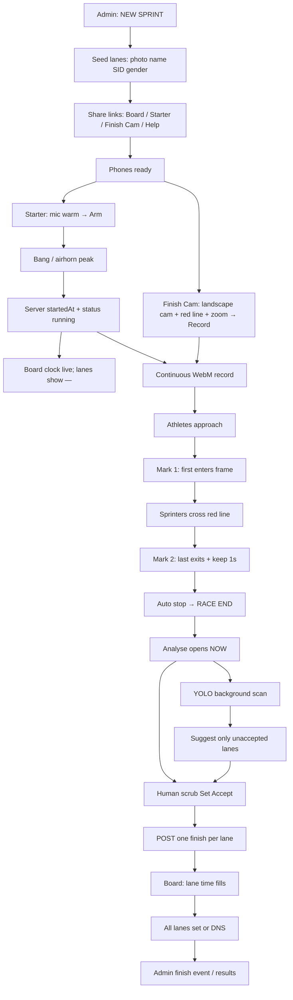

# Sprint Timetrial — complete race-day flow

Source of truth for time: **server `startedAt`** (Starter bang → POST `/start`).  
Finish Cam video is evidence + offset. Manual Accept wins over YOLO.



---

## 1. Admin setup (before athletes)

| Step | Who | Where | What |
|------|-----|-------|------|
| 1.1 | Admin | Create | **NEW SPRINT** → distance 60/100/200/400 (or custom) → gender male/female/mixed |
| 1.2 | Admin | Setup | Fill **lanes**: photo · name · SID · category. Empty name+SID = hidden on Board |
| 1.3 | Admin | Help / QR | Open **Starter** (start phone), **Finish Cam** (finish phone), **Board** (TV/projector). Helper PIN if needed |
| 1.4 | Admin | Board | Open Board early — rows show `—` until finishes |

Event status: `setup`. No `startedAt` yet.

---

## 2. Field capture setup (T−few min)

| Device | Role | Prep |
|--------|------|------|
| Phone A | **Starter** | At start line. Mic warm. Arm when field ready. Bang/airhorn only after Arm |
| Phone B | **Finish Cam** | Landscape at finish. Red centre line on track finish. Zoom digital OK. Tap **Record** before gun (continuous roll) |
| Screen | **Board** | Visible to officials / crowd. Polls event; no PIN |

Optional: Admin phone stays on setup/help, not required during Analyse.

---

## 3. Gun / start (clock locks)

1. Starter: **Arm** → listen for bang/airhorn peak (or manual start if you add it).
2. App **POST `/start`** → server sets `startedAt` (UTC ms) + `status: running`.
3. All clients (Board, Finish Cam) see running clock from that timestamp.
4. False start: Starter **Undo start** (if allowed) clears `startedAt`; Finish Cam keeps rolling or re-records — operator choice.

Soundtrack bang in the WebM = **weak sync only**; never override server clock.

---

## 4. Real sprinters over the line (capture)

Finish Cam already recording. Operator watches athletes:

1. **Mark 1** — first athlete **enters** useful frame (start of analyse window).
2. Athletes **cross the red finishing line** (chest / torso through line = finish moment you care about).
3. **Mark 2** — last athlete **exits** frame (or race clear).
4. App keeps **+1 s**, then **auto-stop** → **RACE END**. WebM stays in memory (`blobRef`); optional download.

Local marks are **video offsets** (ms into the recording), not race times yet.

Race time for a finish frame:

`finishTime = startedAt + (recServerAt_offset_or_frameTime − recordingStartAligned)`

Practically: map video timeline so Mark window aligns to server clock via `recServerAt` when recording began (already noted in Finish Cam stub). Document that mapping in code.

---

## 5. Analyse (human + YOLO, no waiting)

Opens **immediately** on RACE END:

```
┌─────────────────────────────────────────┐
│  Video (Mark1→Mark2) + red line         │
│  scrub · frame step · Set finish lane N │
├─────────────────────────────────────────┤
│  Lane list: time · thumb · Accept       │
│  chip: YOLO scanning… (non-blocking)    │
└─────────────────────────────────────────┘
```

| Path | Behaviour |
|------|-----------|
| **Human** | Scrub to chest-on-line → pick lane → **Set** → **Accept** → API write **that lane now** |
| **YOLO** | Background every Nth frame; person box → lane band; suggest time + snapshot+box |
| **Merge** | YOLO **only** fills lanes not Accepted / not manually locked. Never overwrite |

Accuracy: Board is accurate when **each lane’s Accept** matches the frame you trust. YOLO speeds empty lanes; officials still own disputed ones.

---

## 6. Dashboard / Board (live results)

- Layout: **lane · photo · name (SID) · time** (or `—`).
- Filter: Boys / Girls / All (from create gender).
- Sort: **by lane**, not place (locked preference).
- Each Accept → that row’s time updates live for everyone watching Board.
- When all valid lanes have times (or DNS/DNF marked): results complete; Admin can mark event `finished`.

---

## 7. Accuracy checklist (race day)

- [ ] Starter bang → confirm Board clock started
- [ ] Finish Cam recording **before** gun
- [ ] Red line physically on finish plane
- [ ] Mark1 before first athlete; Mark2 after last
- [ ] Scrub Accept for close finishes / ties
- [ ] YOLO suggestions spot-checked via snapshot+box
- [ ] No lane overwritten after Accept without explicit Edit

---

## Roles (one line each)

- **Admin** — create, lanes, share links, optional event finish  
- **Starter** — gun → server clock  
- **Finish Cam** — video evidence + marks + Analyse (scrub + YOLO)  
- **Board** — public live results  

Distance Timer/Marker flows stay separate; this doc is **sprint only**.

## Lane camera note

Side-on finish cam: do **not** equal-split the frame. Use draggable lane bands (near lane = taller). Map YOLO box feet to band. Head-on/along-line is easier; side-on needs guides.
